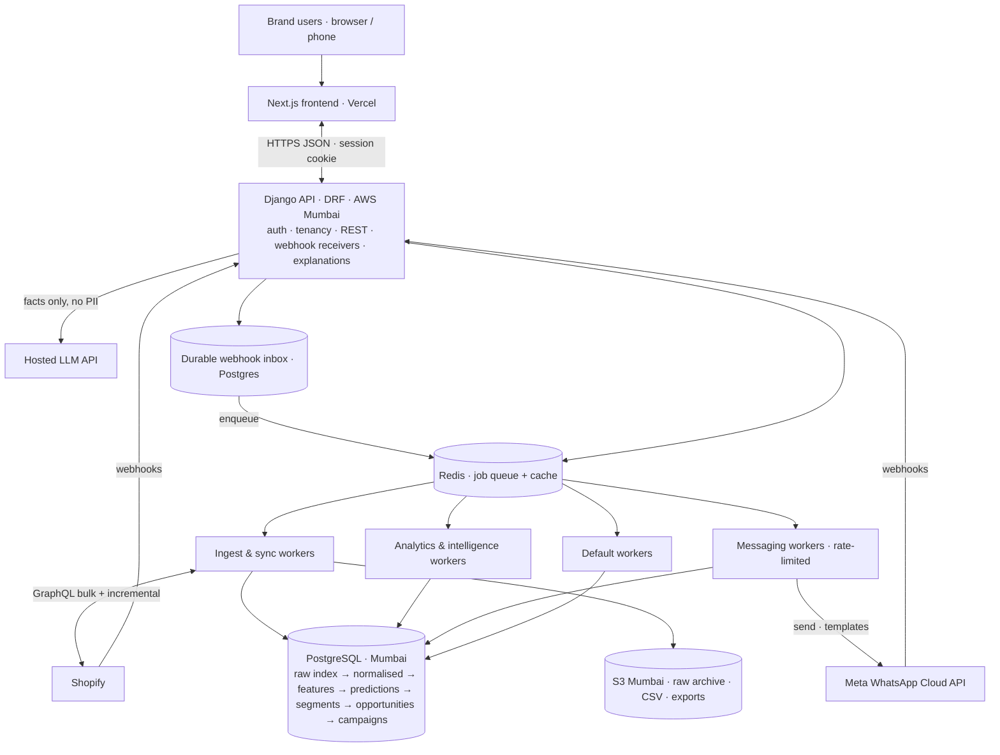

# technical.md — RetentionOS by Moca

> **What this file is:** The complete technical plan: architecture, stack, data, intelligence engine, WhatsApp, campaigns, scale, security, build plan. It also records which decisions are made and which are still open.
> **Who reads it:** Every Claude Code agent before writing code. Founders read the plain-English boxes ("In plain words").
> **Status legend:** ✅ **Decided** · 🟡 **Proposed** (Claude's recommendation, awaiting founder sign-off) · 🔴 **Open** (needs a decision before the milestone that uses it)
> **Rule:** Agents may not change a ✅ decision without founder approval and a `changelogs.md` entry.

Document version: 1.2 · 5 Nov 2026
v1.1 (26 Sep 2026): pointers to the Data & Intelligence PRD, Shopify erase rule, pooled holdouts, WooCommerce M1b, O-15…O-18. v1.2 (5 Nov 2026): M0 scope and stop line (D-038), GitHub setup (D-030), 2-step login as a setting (D-039), Briefing feed (D-037), import order (D-034), game items and gaps G1–G19.

---

## 0. Summary of the technical direction

> **In plain words:** RetentionOS is built as two parts. The **backend** (Django, Python) does all the data work, maths and WhatsApp sending. The **frontend** (Next.js) is the website founders use. The backend stores everything in one well-organised **PostgreSQL** database, with every row tagged by brand so brands never see each other's data. Heavy work (importing orders, computing predictions, sending messages) runs in the background through a **job queue** (Celery + Redis), so the website stays fast no matter how many brands are busy. The **maths is deterministic statistics**: no AI decides anything. A small **hosted LLM** only turns already-computed numbers into plain-English explanations behind **?** icons.

| # | Decision | Status |
|---|---|---|
| T-1 | Backend: Django 5.2 LTS + Django REST Framework, Python 3.12 | ✅ |
| T-2 | Frontend: Next.js 16 (App Router) + React 19 + TypeScript, standalone site (not embedded in Shopify admin) | ✅ |
| T-3 | Database: PostgreSQL (managed, Mumbai region); one shared database, brand_id on every tenant row | ✅ DB engine · 🟡 provider (Supabase Postgres) |
| T-4 | Background jobs: Celery 5.6 + Redis | 🟡 |
| T-5 | Intelligence: deterministic statistics + classical ML; no LLM in the decision path | ✅ · 🟡 excluding Jev (D-008, confirm) |
| T-6 | LLM: hosted API, explanations only, behind a provider-agnostic adapter with numeric validation | ✅ scope · 🔴 provider |
| T-7 | WhatsApp: Meta Cloud API as Meta Tech Provider, Embedded Signup, brands pay Meta directly | ✅ |
| T-8 | Shopify: public app, GraphQL Admin API only, bulk operations + webhooks + reconciliation | ✅ |
| T-9 | Hosting: Vercel (frontend, Mumbai functions) + AWS Mumbai (backend compute) + Supabase Postgres Mumbai | 🟡 |
| T-10 | Billing: Shopify Billing for Shopify-installed brands; Razorpay for direct contracts | ✅ direction · 🔴 plans/prices |
| T-11 | Monorepo on GitHub; Claude Code sessions per workstream, coordinated through repo docs + OpenAPI contract | 🟡 |
| T-12 | GitHub: company organization, private repo `retentionos`, Free plan for now, Team plan before the first outside developer or production (D-030) | ✅ |

---

## 1. Architecture overview



**Key flows**
1. **Connect:** OAuth install → store token (encrypted) → start **bulk backfill** → normalise → identity resolution → first full intelligence run → opportunities.
2. **Real time:** Shopify webhook → verify HMAC → write to inbox → ack in < 1 s → worker normalises → incremental update of that customer's features.
3. **Nightly per brand:** reconciliation → metrics → parameters → predictions → affinity → temporal → segments → opportunities → notifications and Briefing items.
4. **Campaign:** build → eligibility → holdout split → schedule per-customer send slots → messaging workers send within Meta limits → status webhooks → attribution → incrementality.
5. **Explain (`?`):** UI requests an explanation → backend assembles a *facts* JSON from stored values → cache hit? return : LLM → validator → cache → return.

---

## 2. Technology stack and version policy

### 2.1 Version policy (applies to all agents)
- Use only **actively maintained** libraries: a release in the last 12 months, an active issue tracker, and support for our Python/Node versions. Before adding **any** new dependency, the agent must state its maintenance status and why it is needed, and get approval (logged in `changelogs.md`).
- **Exact versions are pinned by lock files** (`uv.lock` for Python, `pnpm-lock.yaml` for Node), generated at repo setup against the latest **patch** of the majors below. Agents must verify compatibility from official docs at setup time. The versions below are the targets as of Sep 2026.
- Dependency updates: weekly Dependabot/Renovate PRs, grouped, merged only if CI passes. Security patches are merged within 72 hours.

### 2.2 Backend

| Concern | Choice | Why / notes |
|---|---|---|
| Language | **Python 3.12** | Widest support for scientific wheels (NumPy, SciPy, LightGBM, PyMC). Re-evaluate 3.13 at milestone M9. |
| Framework | **Django 5.2 LTS** | Security support until Apr 2028. Django 6.1 is newer but non-LTS (support ends Dec 2027). Plan the upgrade to 6.2 LTS (due Apr 2027) as a scheduled task. |
| API | **Django REST Framework 3.18.x** | Supports Django 5.2. |
| API schema | **drf-spectacular** | Generates OpenAPI 3 → typed frontend client. This is the backend↔frontend **contract**. |
| Auth | **django-allauth (headless mode)** + MFA | Email/password, Google login, TOTP for owners, SPA-friendly session cookies. When 2-step login becomes mandatory is a setting (D-039, U-4 open). |
| DB driver | **psycopg 3** | Modern PostgreSQL driver; supports COPY for bulk loads. |
| Jobs | **Celery 5.6.x** + **django-celery-beat** | Industry standard; per-queue workers; retries; schedules. |
| Broker/cache | **Redis 7.x** (or Valkey, its open-source fork) | Celery broker, cache, rate limiters, locks. |
| HTTP client | **httpx** + **tenacity** (retries with backoff) | Shopify / Meta / LLM calls. |
| Phone numbers | **phonenumbers** | E.164 normalisation of Indian numbers. |
| Data/maths | **NumPy 2.x, pandas 2.x (+ pyarrow), SciPy, scikit-learn, LightGBM** | Feature computation, statistics, ML. |
| CLV models | **PyMC-Marketing** (BG/NBD, Gamma-Gamma) | 🟡 Replaces the archived `lifetimes` library. **Phase-0 spike:** confirm it installs and fits quickly in our Docker image. Fallback: our own SciPy maximum-likelihood implementation of BG/NBD (published formulas, ~100 lines, tested against PyMC-Marketing results). |
| Survival curves | In-house Kaplan–Meier (NumPy) | Tiny, fully tested. `lifelines` is used only as a *test oracle* (dev dependency) if still maintained at setup. |
| Storage | **django-storages** (S3) | CSV uploads, bulk JSONL files, exports. |
| Observability | **sentry-sdk**, **structlog** | Errors and structured logs with brand_id/job_id context. |
| Quality | **ruff** (lint + format), **mypy** (django-stubs), **pytest**, **pytest-django**, **factory_boy**, **hypothesis** (property tests for normalisation) | Enforced in CI. |
| Packaging | **uv** | Fast, lock-file based. |

### 2.3 Frontend

| Concern | Choice | Why / notes |
|---|---|---|
| Framework | **Next.js 16 (App Router)**, **React 19**, **TypeScript (strict)** | Next.js 15 leaves maintenance on 21 Oct 2026, so start on 16 and always take the latest security patch (there were security releases in Sep 2026). |
| Styling | **Tailwind CSS 4** + design tokens from `design.md` | |
| Components | **shadcn/ui** (Radix primitives) + **lucide-react** icons | Accessible, owned in-repo, easy to theme. |
| Server state | **TanStack Query 5** | Caching, polling for live progress. |
| Tables | **TanStack Table 8** + **TanStack Virtual** | 1M-row lists via server pagination + virtualisation. |
| Forms | **React Hook Form** + **Zod** | Validation mirrors backend rules. |
| Charts | **Recharts** (via shadcn charts) | Standard charts. Journey visual uses **@xyflow/react (React Flow)** or custom SVG (decided in M7). |
| API client | **openapi-typescript + openapi-fetch** | Generated from the backend OpenAPI schema. Never hand-write API types. |
| Dates/numbers | **date-fns**, `Intl.NumberFormat('en-IN')` | ₹, lakh/crore formatting. |
| Testing | **Vitest** + Testing Library; **Playwright** E2E | |
| Package manager | **pnpm** | |

### 2.4 What we deliberately do **not** use in V1
- **Supabase Auth, Supabase Data API (auto REST) or Row Level Security as the primary access path.** Django is the only thing that talks to the database. The Data API is disabled to remove an attack surface.
- **Django Channels / WebSockets.** Live progress uses polling (TanStack Query, 3–10 s intervals). Fewer moving parts; revisit if needed.
- **Microservices / Kafka / a separate data warehouse.** A well-structured modular Django monolith + PostgreSQL comfortably serves 1,000 brands. We split only when measurements demand it.
- **Any LLM or Jev in the decision path.** See §7.1.

---

## 3. Infrastructure, hosting and cost

> **In plain words:** We start small and cheap, but with the *same code* that will run at 1,000 brands. Everything runs in Docker containers, so moving from one small server to an auto-scaling cluster is a configuration change, not a rewrite.

### 3.1 Recommended setup 🟡 (T-9, needs founder sign-off on spend)

| Component | Stage 1: pilots (≤ ~50 brands) | Stage 2: growth (→ 1,000 brands) |
|---|---|---|
| Frontend | Vercel **Pro** (the Hobby plan is non-commercial), functions in `bom1` Mumbai | Same |
| Backend API + workers + beat | One AWS Mumbai VM (e.g. 8 GB RAM) running Docker Compose: `api`, `worker-ingest`, `worker-analytics`, `worker-messaging`, `beat`, `redis` | AWS ECS Fargate services per role with autoscaling on queue depth; managed Redis (ElastiCache/Valkey) |
| Database | Supabase **Pro**, Mumbai (`ap-south-1`), Small–Medium compute; direct or session-mode connection from Django | Supabase XL/2XL compute with read replica for analytics reads, **or** migrate to AWS RDS/Aurora (decide on measured load; see §15) |
| Object storage | AWS S3 Mumbai | Same |
| Email (invites, alerts) | Amazon SES Mumbai | Same |
| Edge security | Cloudflare (free) in front of `api.` (DNS, TLS, DDoS, basic rate limits) | Cloudflare Pro/WAF if needed |
| Errors / logs | Sentry (free → Team), CloudWatch logs | Same + dashboards/alerts |
| LLM | Hosted API, pay-per-use (cached; small) | Same |

**Why Supabase + AWS Mumbai together:** Supabase's Mumbai region runs on AWS `ap-south-1`, so backend ↔ database latency stays within one AWS region (low single-digit milliseconds). You already have Supabase and Vercel accounts. Cross-provider hops (e.g. a Bangalore server talking to a Mumbai database) add latency to every query and are avoided.

**Indicative monthly cost, Stage 1** (verify at sign-up; USD, excl. GST): Supabase Pro $25 + compute ≈ $15–60 · AWS VM ≈ $40–80 · Vercel Pro ≈ $20 per member · S3/SES/Cloudflare ≈ $5–15 · Sentry free · LLM ≈ $5–20. **Total ≈ $120–250 / month.** Meta messaging costs are paid by each brand directly.

**Stage 2 (1,000 brands):** expect roughly $1.5k–5k / month depending on data volumes (database compute and storage dominate). This should be a small fraction of subscription revenue at that scale. Re-estimate with real data at 100 brands.

🔴 **O-01:** Founder to approve the Stage-1 setup and budget, **or** choose the alternative "all-AWS" (RDS instead of Supabase: one vendor, slightly more setup). Until then, M0 runs locally only (Docker Compose); no staging deploy (D-038).

### 3.2 Environments
- **local:** docker compose (Postgres, Redis, API, workers) + Next.js dev server; seeded with synthetic brands.
- **staging:** separate Supabase project + small VM + Vercel preview; uses Shopify **development stores** and a Meta **test** WhatsApp number. Pilot brands may be invited to staging. (After O-01.)
- **production:** separate everything; access restricted to founders + CI deploy role.
- **Test data never touches production and production data never touches staging** (a Shopify Level-2 requirement).

### 3.3 Deployment
GitHub Actions: on PR → lint, type-check, tests (with a Postgres + Redis service), build images. On merge to `main` → auto-deploy to staging. On a release tag → **manual approval** → production. Database migrations run as a separate step before new code starts. Migrations must be backwards-compatible (expand → migrate → contract) so deploys never cause downtime. (Deploy steps are added once O-01 is decided; on the GitHub Free plan the manual-approval environment rule needs the Team upgrade, D-030.)

---

## 4. Backend structure

### 4.1 Repository layout (monorepo)

```
retentionos/
├── CLAUDE.md               ← agent entry point (rules + where to look)
├── project.md              ← vision + PRD
├── technical.md            ← this file
├── design.md               ← frontend rules
├── changelogs.md           ← decision & change log
├── docs/                   ← PRD for data & intelligence, risk review, play map, game log, milestones/
├── backend/
│   ├── pyproject.toml, uv.lock, Dockerfile
│   ├── config/             ← settings (base/local/staging/prod), urls, celery app
│   ├── apps/               ← Django apps (below)
│   └── tests/              ← cross-app tests, fixtures, synthetic data generator
├── frontend/
│   ├── package.json, pnpm-lock.yaml
│   ├── src/app/            ← Next.js routes
│   ├── src/components/     ← ui (shadcn) + feature components
│   ├── src/lib/api/        ← GENERATED OpenAPI client (do not edit)
│   └── tests/
├── infra/                  ← docker-compose, deploy configs, IaC (later)
└── .github/workflows/
```

### 4.2 Django apps 🟡 (final split confirmed in the M0 planning session)

| App | Responsibility |
|---|---|
| `core` | Tenancy base models/managers, IDs, time utils, money, encryption helpers, feature flags |
| `accounts` | Users, auth (allauth), memberships, roles, invitations, MFA |
| `brands` | Brand (tenant), settings, **Brand Knowledge Profile** (versioned questionnaire), guardrails |
| `integrations_shopify` | OAuth install, token storage, GraphQL client, bulk backfill, webhooks, reconciliation, compliance webhooks, discount-code creation, billing API |
| `ingestion` | Inbox, raw records, CSV import, normalisation pipeline, data-quality report |
| `commerce` | Normalised Customer, Order, LineItem, Product, Variant, Category, Refund |
| `identity` | Identity resolution, merges/unmerges, identifier index |
| `analytics` | Metric definitions, brand daily metrics, cohorts, customer feature table |
| `intelligence` | Adaptive parameters, RFM, lifecycle, BG/NBD, LTV, reorder windows, affinity, discount sensitivity, temporal patterns, send-time, model runs |
| `segments` | Rule schema, auto segments, audience compiler (rule JSON → SQL) |
| `opportunities` | Daily opportunity generation, ranking, dedupe, dismissals |
| `whatsapp` | WABA connections, template library + per-WABA submissions, consent, suppression, sender, status processing, inbound replies/opt-outs, quality |
| `campaigns` | Campaign, variants, recipients, holdout, scheduling, offers, discount codes, short links, attribution, experiment analysis |
| `explanations` | Facts builders, LLM adapter, validator, cache |
| `billing` | Plans, entitlements, Shopify Billing, Razorpay subscriptions, usage |
| `audit` | Audit log (append-only) |
| `notifications` | Email + in-app notifications and the daily **Briefing** feed (D-037) |

### 4.3 Code conventions (enforced by review)
- **Tenancy:** Every tenant model inherits `TenantModel` (`brand = FK(Brand, db_index=True)`) and uses a `TenantManager`. Querying without an explicit brand scope raises an error in tests. API views get the brand from the URL (`/api/v1/brands/{brand_id}/...`) and check membership + role via a single permission class. A **tenant-isolation test suite** hits every endpoint with a user from brand A requesting brand B's objects and expects 404.
- **Layers:** `models.py` (data), `services.py` (write/business logic), `selectors.py` (read queries), `tasks.py` (Celery entry points only, which call services), `api/` (serializers, views). No business logic in views or serializers.
- **IDs:** `BigAutoField` primary keys internally. Public IDs exposed in URLs/API are UUIDv7 or prefixed IDs, never sequential integers (prevents enumeration).
- **Money:** stored as integer **paise** (`BigIntegerField`) + currency code. Never floats.
- **Time:** stored in UTC (`timestamptz`). The brand timezone (from Shopify, default `Asia/Kolkata`) is used for all "day", "hour" and "day-of-month" logic.
- **Idempotency:** every task and webhook handler is safe to run twice (upserts keyed by `(brand, source, external_id)`; send jobs keyed by `(campaign_recipient_id)`).
- **Bulk writes:** use `COPY`/`bulk_create(update_conflicts=True)` in batches (e.g. 5,000 rows); never row-by-row loops for large data.
- **Migrations:** reviewed for lock safety on large tables (no long table rewrites; add indexes `CONCURRENTLY`).

---

## 5. Data architecture

> **In plain words:** Data flows through layers, like a factory line. We keep the **raw** data exactly as Shopify sent it, archived cheaply in file storage (so nothing is ever lost and we can re-process), then produce a **clean** version (duplicates merged, phone numbers fixed, test orders removed), then compute **features** per customer (orders, intervals, value), then **predictions**, then **segments and opportunities**. Each layer can be rebuilt from the one before it.

### 5.1 Layers

| Layer | Tables (main) | Written by | Rebuildable from |
|---|---|---|---|
| L0 Inbox | `webhook_inbox`, `sync_job`, `bulk_file` | Webhook receivers, sync jobs | — (source of truth for arrivals) |
| L1 Raw | Compressed JSONL archive in **S3** (per batch/day) + `raw_index` table in Postgres (brand, source, object_type, external_id, payload_hash, s3_key, source_updated_at) | Ingestion | Shopify re-sync |
| L2 Normalised | `customer`, `customer_identifier`, `order`, `order_line`, `product`, `variant`, `category`, `refund`, `consent_record` | Normaliser + identity | L1 |
| L3 Features | `customer_features` (one wide row per customer), `brand_metrics_daily`, `cohort_cell`, `product_stats` | Analytics | L2 |
| L4 Intelligence | `brand_parameter` (versioned), `customer_prediction`, `product_affinity`, `temporal_pattern`, `model_run` | Intelligence | L2 + L3 |
| L5 Action | `segment`, `opportunity`, `campaign`, `campaign_recipient`, `message`, `message_event`, `attribution` | Segments, opportunities, campaigns, WhatsApp | — |

### 5.2 Core entities (abridged)
- **Brand** (tenant): name, timezone, currency, platform, plan, status.
- **Customer**: brand, canonical profile (name, primary phone E.164, primary email, city/state/pincode, first_order_at, last_order_at, lifecycle fields cached), `merged_into` (for merges).
- **CustomerIdentifier**: (brand, type ∈ {shopify_id, phone, email, csv_id}, normalized_value) → customer. **Unique per brand**, which drives identity resolution.
- **Order**: brand, customer, external_id, created_at (brand-local derived fields), currency, gross/discount/shipping/tax/net amounts (paise), `financial_status`, `fulfillment_status`, `payment_gateway` / `is_cod`, `is_test`, `cancelled_at`, **`counts_as_purchase`** (derived; see §6.4), source/UTM/landing site, discount codes used.
- **OrderLine**: order, product, variant, quantity, price, discount, refunded quantity.
- **Product / Variant / Category**: title, type, vendor, tags, brand taxonomy mapping, **`consumption_class`** ∈ {consumable, durable, mixed, unknown} and its source (data / questionnaire / rule).
- **ConsentRecord**: customer, channel (whatsapp), status (opted_in / opted_out / unknown), source (shopify_sms_consent / csv / opt-in link / reply / manual), evidence, timestamp. **Append-only history**; the current state is derived from it.
- **CustomerFeatures** (wide, 1 row/customer, recomputed): orders_count, net_revenue, AOV, first/last order, days_since_last, interval stats (mean, median, CV, count), categories, discount share and depth, preferred weekday/hour, COD share, RTO count, last campaign stats, etc. **All audience-builder fields read from here**, which keeps counts fast.
- **CustomerPrediction**: p_alive, expected purchases in 30/90 days, next purchase window (p25/p50/p75 dates), churn risk band, predicted 12-month value, next-best product(s), recommended send hour, language, confidence per field, **reason codes**, model_run_id. (Gap G5: keep weekly snapshots of key predictions; decision pending.)

### 5.3 Indexing, partitioning, retention
- Every tenant table has indexes **leading with `brand_id`** (e.g. `(brand_id, last_order_at)`, `(brand_id, customer_id, created_at)`).
- **Partitioned from day one** (append-heavy, time-based): `message_event` and `webhook_inbox` by **month** (PostgreSQL declarative partitioning, created by a scheduled task). Old partitions are dropped per retention policy: raw inbox 30 days after processing; message status events **90 days** (final status is kept on `message`).
- **Not partitioned in V1:** commerce tables (customers, orders, lines). PostgreSQL handles hundreds of millions of rows with brand-leading indexes. We revisit at ~100M orders or when measured query times breach targets. (🟡 D-013)
- Raw payloads live in S3 (cheap, compressed), not in Postgres. `raw_index` keeps one row per external object version (dedupe by hash) so any record can be re-processed. Raw archive retention: 13 months (🟡).

---

## 6. Data ingestion, quality and identity

> **Detailed spec:** the full data lists, CSV importer (Jev-assisted mapping) and WooCommerce connector are in `docs/data-and-intelligence-prd.md` Part A. It takes precedence over this section where more specific. Where every play's data comes from, and the known data gaps (G1–G19), are in `docs/play-map.md`.

### 6.1 Shopify app (✅ T-8)
- 🔴 **O-15 must be decided before M1:** keep the teammate's Node.js Shopify app as a "Shopify edge" service, or port it into Django (PRD §A2.8).
- **Public app**, listed on the Shopify App Store + an install link from our website (both land in the same account flow: **one shared account pool**, D-031).
- **GraphQL Admin API only** (new public apps must use GraphQL). The API version is pinned in config (e.g. `2026-07`) and upgraded **every quarter**, a recurring maintenance task (each Shopify API version is supported for about 12 months).
- **Scopes (minimum necessary):** `read_customers`, `read_orders` + **`read_all_orders`** (by default apps only see the last 60 days of orders; full history needs Shopify approval), `read_products`, `write_discounts` (unique offer codes), plus billing. **Protected customer data Level 2** (name, email, phone, address) must be requested and approved. Without it, live stores return no PII. `read_inventory` and `write_orders` are added only if plays that need them enter V1 (gap G16).
- **Our own thin GraphQL client** (httpx) that respects Shopify's cost-based rate limits (reads `throttleStatus`, sleeps, and retries). No heavy SDK.
- **Historical backfill:** Shopify **Bulk Operations** (`bulkOperationRunQuery`) for products, customers, orders (+ lines, refunds, discount applications) → download JSONL to S3 → stream-parse → archive to L1 → batch upsert into L2. **Order: collections and products first, then customers, then orders** (D-034), so onboarding can pre-fill "What do you sell?" early. Progress is tracked in `sync_job` and drives the live import screen (D-032). Resumable.
- **Webhooks:** `orders/create`, `orders/updated`, `orders/cancelled`, `refunds/create`, `customers/create`, `customers/update`, `customers/delete`, `products/create`, `products/update`, `products/delete`, `app/uninstalled`, `shop/update`, and the **mandatory compliance webhooks** `customers/data_request`, `customers/redact`, `shop/redact`. Receiver: verify HMAC → dedupe on the webhook id header → insert into `webhook_inbox` → return 200 immediately → worker processes.
- **Reconciliation (safety net):** every night (and every 6 h for large brands), query objects with `updated_at > last_reconciled_at` and upsert. Webhooks can be delayed or dropped; reconciliation guarantees correctness.
- **Uninstall:** stop syncs and delete the access token immediately. Erase the store's data when Shopify's `shop/redact` arrives (48 h after uninstall), per Shopify rules (🟡 D-027, resolves O-10 for Shopify).

### 6.2 CSV import
Guided upload (customers, orders, order lines, products) → column-mapping UI with auto-detection → validation report (row-level errors downloadable) → the same normalisation pipeline as Shopify (source = `csv`). Required minimum: order id, order date, customer identifier (phone or email), order amount. Large files (up to ~2 GB) are uploaded straight to S3 via pre-signed URL and parsed in workers. (Jev-assisted mapping: PRD §A3, D-022.)

### 6.3 Normalisation rules (the "duplicates, missing values, normalisation" problem)

| Field | Rule |
|---|---|
| Phone | Parse with `phonenumbers` (default region IN) → E.164 (`+9198…`). Strip spaces, dashes, leading 0, `+91` duplicates. Invalid → stored raw, flagged, **not** used for WhatsApp. |
| Email | Trim, lowercase. Validate syntax. Do **not** strip Gmail dots or `+tags` (can merge different people). |
| Names | Trim, collapse whitespace, title-case for display only (raw kept). |
| Address | State normalised to a canonical list of Indian states/UTs (handles "TN", "Tamilnadu", "Tamil Nadu"). Pincode validated (6 digits). City kept as given. |
| Money | Integer paise. Shop currency vs presentment currency both kept; analytics use shop currency. |
| Time | Stored UTC. Brand timezone used for day/hour features. |
| Test orders | `test = true` orders are excluded from everything. |
| Cancelled | Cancelled orders are excluded from purchase behaviour (kept for data-quality stats). |
| Refunds | Net revenue = gross − discounts − refunds. Fully refunded orders don't count as purchases. Partial refunds reduce value. |
| **COD / RTO (India)** | COD orders are identified from the payment gateway / payment terms. A COD order counts as a purchase only when **paid or fulfilled and not returned**. Orders cancelled or returned after dispatch are flagged `rto_suspected`. Until resolved (default: order age < 15 days and unpaid), they count as **pending**: included in recency, excluded from value and frequency. Rules are brand-configurable. (Gap G2: delivery and RTO data from Indian logistics apps is often missing in Shopify.) |
| Missing values | Never invent values. Missing phone → no WhatsApp. Missing product mapping → category `unknown`. Features requiring missing inputs are `null`, and the confidence drops accordingly. Every gap is counted in the data-quality report. |
| Duplicated orders | Upsert by `(brand, source, external_id)`. Identical payload hash → no-op. |

### 6.4 `counts_as_purchase`
A single derived boolean on each order, used by *all* analytics, so every metric agrees:
`not test AND not cancelled AND not fully_refunded AND (not is_cod OR cod_confirmed)`, with pending COD handled as above. Defined once in `commerce/selectors.py` and unit-tested against a fixture table of 30+ tricky cases.

### 6.5 Identity resolution
- Deterministic in V1 (no fuzzy name matching). Records are the **same customer** if they share a normalised **phone** or **email** or **Shopify customer id** within the brand.
- Implemented as a union-find over `customer_identifier`. The canonical customer = the oldest record. Others get `merged_into`. Orders are re-pointed. Every merge is written to `identity_merge_log` (what, why, which identifier), which is visible in Customer 360 and reversible (unmerge).
- **Guard rails:** Identifiers shared by an unusually large number of records (e.g. a store's own phone number or `test@…` used on many orders) are auto-detected (> N customers, default 20) and **excluded from matching**, so they don't collapse thousands of people into one.
- Runs incrementally on each new record and fully during backfill.

### 6.6 Data-quality report (shown at onboarding and in Settings)
Counts and percentages of: customers without phone / invalid phone, without email, duplicates merged, test/cancelled orders excluded, COD share, RTO-suspected share, refunds, products without category, orders outside expected ranges (e.g. ₹0 or extreme values), date coverage. Each item has a plain-English "what this means for your results".

---

## 7. Intelligence engine

> **In plain words:** Every night (and in small pieces during the day) the engine reads each brand's clean purchase history and works out, for every customer: how often they rebuy, when they're next due, whether they're slipping away, what they're worth, what they're likely to buy next, which hour they read messages, and whether they need a discount at all. It uses well-known statistics, not AI guesses, so every number can be explained and checked. Where the brand has little data, it starts from the founder's questionnaire answers and gradually trusts the data more as it grows.

> **Detailed spec:** Every model (inputs, outputs, maths, defaults, minimum data, confidence) is specified by ID in `docs/data-and-intelligence-prd.md` Part B (E-01…E-24, DEC-01…DEC-08, MEA-01…MEA-06, X-01…X-03, parameter registry §B9). That spec wins where it is more specific. Known corrections awaiting approval are F-1…F-11 in `docs/risk-review.md`.

### 7.1 Principles (✅ T-5)
- **Deterministic and explainable.** Same data + same parameters → same outputs. Every prediction stores **reason codes** and the model_run that produced it.
- **No LLM or Jev in the decision path** (D-004, D-008). The only AI uses are: the LLM writes `?` explanations from computed facts (D-021: no personal data), and Jev suggests CSV column matches that a human confirms (D-022). 🟡 Confirm Jev stays excluded from product categorisation (O-06).
- **Generic, never pilot-specific** (D-010, D-020): consumable vs durable vs mixed is learned from each product's repeat behaviour, not from a category list.
- **Honest uncertainty.** Every output carries a confidence label (High / Medium / Low) derived from sample size and spread (X-02). Low-confidence values are shown as ranges and are never used for automatic actions without a human.
- **Starting assumptions, then data.** Questionnaire answers are priors; the data takes over as evidence grows (§7.3, D-034, D-036).

### 7.2 Pipeline (per brand, nightly; incremental per customer on new orders)

| Step | What it computes | Model / method | PRD ID |
|---|---|---|---|
| 1 | Purchase occasions (clean orders, split orders merged, COD/RTO handled, refunds) | Rules (§6.3–6.4) | E-01 |
| 2 | Customer facts (counts, dates, spend, AOV, intervals), RFM scores | Aggregation, brand-relative quantiles | E-02, E-06 |
| 3 | Product facts (pack sizes parsed, families, price bands) | Parsing + rules | E-03 |
| 4 | Brand metrics and monthly cohorts | Metric catalogue | E-04, E-05 |
| 5 | Reorder rhythm per brand → category → product | **Kaplan–Meier** survival curves (customers who haven't reordered yet are counted correctly as "censored", not ignored) | E-07 |
| 6 | Blend founder answers with data | Hierarchical **shrinkage in log-space**: `w = n / (n + k)`, with k = 30 (brand), 20 (category), 10 (product), 2 (customer) | E-08 |
| 7 | Consumption class per product | Repeat-rate of the same product: ≥ 15% consumable · < 5% durable · between = mixed; founder answer holds until ~200 buyers | E-09 |
| 8 | Personal reorder window | Threshold ladder on the blended curve: p25 "window opens", p50 "due", p75 "late", p80 "at risk", p95 "lapsed" | E-10, E-17 |
| 9 | Lifecycle stage + health | Rules on the windows (D-011) | E-11, E-12 |
| 10 | Churn risk | Shape of the reorder curve past the customer's due date | E-13 |
| 11 | Probability still active, expected purchases | **Modified BG/NBD** (F-1: MBG/NBD, because plain BG/NBD says one-time buyers can never churn) | E-14 |
| 12 | Expected order value, 12-month value | **Gamma-Gamma** | E-15 |
| 13 | Challenger for expected purchases | **LightGBM** on customer features; promoted only if it beats E-14 in backtests | E-16 |
| 14 | Value tiers / VIP | Spend percentile or the brand's VIP rule (Q3.8) | E-18 |
| 15 | Discount sensitivity / dependency | Share and depth of discounted purchases (codes, automatic discounts, sale prices: gap G4) | E-19 |
| 16 | Product affinity A → B | Lift + support with **Benjamini–Hochberg** false-discovery control; minimum 30 customers per pair | E-20 |
| 17 | Next best product | Affinity + rhythm + popularity fallback (gap G18: attribute similarity for one-off designs) | E-21 |
| 18 | Temporal patterns | Day-of-month, weekday, festival lift (vs Moca calendar, U-8) | E-22 |
| 19 | Best send hour | Order hour first, then read-time from WhatsApp events (MEA-04) | E-23 |
| 20 | Message language | Opt-in choice > founder's state rule (Q1.3) > brand default | E-24 |

All outputs are written to `customer_prediction` / `brand_parameter` / `product_affinity` / `temporal_pattern` with a `model_run_id`. Old runs are kept for 30 days for comparison (gap G5 proposes weekly snapshots for longer).

### 7.3 Questionnaire priors and "your answer vs your data"
- Each questionnaire answer that maps to a number (e.g. "one bottle lasts 45 days") becomes a **prior** with a pseudo-count k (above). Answers are stored in the versioned **Brand Knowledge Profile**; changes create a new version.
- The questionnaire **never waits for the data** (D-034). If the data has arrived, questions the data can answer are **pre-filled**; otherwise they offer **"Fill this from my data"** (D-035).
- When data and answer disagree, the notice tiers apply (D-036): ✅ within 15% "Your data agrees" · 🟡 15–50% off "Slight adjustment" (blend used, founder told) · 🔴 more than 1.5× or under 0.67× "Big difference": switch to the data value automatically, **only at Medium confidence or above (≥ 50 reorders)**, with "Revert to my answer" in Parameter Studio and an impact preview. Thresholds are 🟡 defaults stored in the parameter registry.
- Notices are written to the **Briefing** feed as "Adjustments" (D-037).

### 7.4 Model runs, versions, backtests
- `model_run` records: brand, step, code version, parameter-set version, data cut-off, row counts, duration, metrics.
- **Backtests (MEA-05):** monthly per brand: hide the last 90 days, predict, compare. Reported internally; a model that degrades is flagged and falls back to the simpler one.
- **Parameter Studio** (X-03): founders see and override key parameters (rhythm per category, thresholds, caps) with an impact preview; every override is audited and versioned.

### 7.5 Minimum data and confidence
Every model declares its minimum data (PRD §B9). Below it, the engine uses the next level up (customer → product → category → brand → questionnaire → Moca default) and labels the result Low confidence. Rough data levels (from `docs/play-map.md`): Level 1 < ~500 buying customers or < 6 months; Level 2 ~500+ customers, 6+ months, ~100+ reorders in the main category; Level 3 ~5,000+ customers, 12+ months and/or holdout history.

### 7.6 Known gaps that affect the engine (decide before the milestone that uses them)
G2 delivery/RTO truth · G3 cost per item for margins · G4 sale prices as discounts · G5 prediction history · G15 unspecified calculations · G17 category-aware replenishment wording · G18 similar-item recommendations · G19 gift/occasion rebuys misread as consumption. See `docs/play-map.md` and the game log (U-9, U-12, U-13).

---

## 8. Decisioning: opportunities and offers

> **In plain words:** Each morning the engine turns predictions into a short to-do list for the founder: "412 customers are due for a reorder this week; send them a reminder", ranked by expected extra revenue. It also decides, per customer, whether any discount is needed and the smallest one that pays for itself.

| Step | What | PRD ID |
|---|---|---|
| Eligibility per opportunity type (second purchase, replenishment, cross-sell, at-risk, win-back, VIP, festival…) | Rules on predictions + consent + caps | DEC-01 |
| Suppression and pauses | Opt-outs, invalid numbers, recent refund/RTO/complaint (pause N days), quiet hours, caps (Q5.1, Q5.2) | DEC-02 |
| Conflict resolution | One owner per question (e.g. "when" belongs to rhythm), **one marketing message per customer per day**, priority by expected incremental value, tie-break by recency of last message | DEC-03 |
| Offer selection | **Expected incremental profit (EIP):** `EIP(offer) = P(buy | offer) × margin_after_offer − P(buy | no offer) × margin` ; pick the highest EIP, which is often "no offer"; respects max discount (Q3.3) and never-discount products (Q3.6) | DEC-04 |
| Scheduling | Per-customer send slot: next allowed slot in their best hour, in brand timezone, outside quiet hours | DEC-05 |
| Cross-sell timing | At the measured A→B gap, not a fixed 21 days (U-12) | DEC-06 |
| Ranking on Home | By expected incremental revenue × confidence; dedupe; dismissals remembered | DEC-07 |
| Holdouts | Random holdout per campaign (≥ 100 recipients) + optional program holdout (D-028, D-029) | DEC-08 |

Opportunities are **suggestions**; nothing is sent without a human launch in V1 (R-7).

---

## 9. Segments and the audience compiler
- Segments are stored as a **rule JSON** (field, operator, value, AND/OR groups) validated against a field catalogue that lists every allowed `customer_features` / `customer_prediction` column.
- The compiler turns rule JSON into a parameterised SQL query (never string concatenation), always scoped by brand. Counts return in < 1 s for 1M customers (indexes + the wide feature table).
- Auto segments (lifecycle stages, value tiers, due-this-week…) are system segments, read-only, refreshed nightly.
- A segment snapshot is frozen at campaign launch, so results stay reproducible.

---

## 10. WhatsApp (✅ T-7)

> **In plain words:** Moca becomes an official Meta "Tech Provider". Each brand connects its own WhatsApp Business number through Meta's pop-up (Embedded Signup) and pays Meta directly for messages. We store the brand's access key securely, submit message templates for Meta's approval, send messages within Meta's limits, and record every delivered/read/replied/failed signal.

- **Embedded Signup** → store WABA id, phone number id, system-user token (encrypted). Webhook subscription per WABA.
- **Templates:** a Moca template library (objective × tone × language: English, Hindi, Tamil, D-007) submitted per WABA; status tracked (approved / rejected / paused). Category-aware replenishment wording is gap G17. Template content = O-13.
- **Sending:** `worker-messaging` with a per-WABA token-bucket rate limiter (respects Meta throughput and the number's messaging tier). Every send job is idempotent on `campaign_recipient_id`. **Consent, suppression and caps are re-checked immediately before each send** (R-7).
- **Status webhooks:** sent / delivered / read / failed → `message_event` (partitioned) → final status on `message`. Failure codes for "not on WhatsApp" feed reachability (gap G11).
- **Inbound:** STOP / opt-out keywords (English, Hindi, Tamil) → consent record + suppression within seconds. Reading other replies with Jev is undecided (G13); V1 = keywords only.
- **Quality:** track the number's quality rating and messaging limit; pause campaigns automatically on a "low" rating and alert the founder (Briefing 🔴).
- **Consent source** is gap G1 / O-04: our own opt-in capture (link/QR, thank-you page block, WooCommerce checkbox); whether Shopify SMS consent counts is a legal decision.

---

## 11. Campaigns and measurement
- **Campaign:** opportunity or segment → template + variables → offer (DEC-04) → holdout split → per-customer schedule (DEC-05) → human launch → send → results.
- **Discount codes:** unique per recipient via Shopify `discountCodeBasicCreate` (bulk), expiry set by the campaign; codes recorded for attribution.
- **Short links:** our own redirect domain with click logging (no third-party shortener).
- **Attribution (MEA-01):** orders within 7 days of a delivered message, matched by code > link click > delivery. Shown as "attributed revenue".
- **Incrementality (MEA-02, D-028):** holdouts are applied to every automated campaign with **≥ 100 recipients**. The headline **"caused revenue"** is **pooled per opportunity type over rolling 90 days**; single-campaign numbers are shown with honest ranges. (Detecting a +20% lift in one campaign with a 10% holdout needs roughly 22,000–79,000 recipients, which most campaigns never reach.) Optional program holdout: D-029.
- **A/B tests (MEA-03):** two templates or two offers; winner chosen with a pre-set minimum sample and a sequential test, not by peeking.
- **Savings** (Briefing 💰) are measured against the brand's **own usual discount** (Q3.2, U-10), never inflated.
- Follow-up sequences ("remind, then follow up if no purchase") are gap G6.

---

## 12. Explanations (`?` popovers) (✅ T-6 scope · 🔴 O-03 provider)
- `explanations` app builds a **facts JSON** from stored values only (numbers, labels, reason codes, confidence), with **no personal data** (D-021).
- Provider-agnostic adapter (one interface; provider chosen by evaluation, O-03). Prompt templates are versioned files.
- **Validator:** every number in the LLM's answer must appear in the facts (with allowed rounding); otherwise the answer is rejected and a **template fallback** sentence is shown.
- Cached by `(facts_hash, template_version, language)`; pre-warmed for Home items by the explain queue (pre-warming explanation cache for the day's top opportunities).
- Budget guard: per-brand daily call limit; on provider outage, fallback text.

---

## 13. Frontend architecture

> **In plain words:** The website is a Next.js app that only *shows* things; it never calculates business numbers itself. It talks to the backend through an automatically generated, typed client, so the two can't silently drift apart.

- **Routes (App Router):** `(auth)/` sign-up, log-in, verify, reset, 2-step · `onboarding/` create brand, connect store, import progress, questionnaire, connect WhatsApp, data report · `b/[brandId]/` home, briefing, opportunities, customers, segments, campaigns, insights, parameter studio, settings.
- **Data:** TanStack Query for all server state; polling (3–10 s) for live progress (import, sends). No global client store beyond UI state.
- **API client:** generated from the OpenAPI schema (`openapi-typescript` + `openapi-fetch`) into `src/lib/api/` (never hand-edited). CI fails if the committed client differs from a fresh generation ("OpenAPI drift check").
- **Auth:** allauth headless session cookie (HttpOnly, Secure, SameSite=Lax) + CSRF token; the frontend and API share a parent domain (`app.` and `api.`).
- **Rules:** `design.md` §1–§7 are binding (components, numbers in `en-IN`, ₹ formatting, empty/loading/error states, the `?` popover pattern, confidence labels). The UI never computes metrics (R-9).
- **Accessibility:** WCAG 2.2 AA target; keyboard navigation; Playwright + axe checks on key pages.
- **Performance:** server components for static shells; tables use server pagination + virtualisation; Lighthouse budget on CI for key pages.

---

## 14. API design
- REST, JSON, versioned under `/api/v1/`. Brand-scoped resources at `/api/v1/brands/{brand_id}/…`.
- **OpenAPI 3 (drf-spectacular) is the contract.** Backend changes that alter the schema must regenerate the client in the same PR.
- Cursor pagination for large lists; filtering through explicit query parameters (no free-form query language).
- Errors: one JSON shape `{code, message, details, request_id}`; `message` is plain English.
- Long jobs return `202` + a job resource the frontend polls.
- Webhook endpoints (`/webhooks/shopify/…`, `/webhooks/meta/…`) are separate from the user API and verify signatures before anything else.
- Rate limits per user and per brand (Redis), stricter on auth endpoints.

---

## 15. Scale and performance (target: 1,000 brands)

> **In plain words:** One brand doing a big import must never slow down another brand. Work is split into separate queues with their own workers, every query is scoped and indexed by brand, and we measure before we split anything further.

| Queue | Work | Notes |
|---|---|---|
| `ingest` | Webhook processing, bulk backfill, reconciliation, CSV parsing | Per-brand concurrency cap (fair sharing) |
| `analytics` | Features, intelligence runs, segments, opportunities | Nightly runs staggered across brands by timezone and size |
| `messaging` | Sends, status processing, inbound replies | Per-WABA rate limits; highest priority |
| `explain` | Pre-warming explanation cache for the day's top opportunities | Low priority; budget-guarded |
| `default` | Emails, exports, housekeeping | |

**Targets (measured in CI load tests from M2):** API p95 < 300 ms for normal pages · audience count < 1 s at 1M customers · webhook ack < 1 s · nightly run for a 100k-customer brand < 10 min · backfill 1M orders < 2 h (depends on Shopify limits; see U-5).
**Database:** connection pooling (Django persistent connections + PgBouncer/Supavisor in session mode); analytics reads can move to a read replica; `COPY` for bulk loads; partitions for event tables (§5.3).
**When to re-architect:** only on measured triggers: e.g. DB CPU > 70% sustained, nightly window overrun, or > 100M orders. Options then: bigger compute, read replicas, partitioning commerce tables, or moving to RDS/Aurora.

---

## 16. Security and privacy

> **In plain words:** Customer names, phones and emails are locked with encryption field by field. Brands can never see each other's data. Nobody (including us) uses production data in development. AI services never receive personal data.

- **Tenancy isolation** (R-3) + the isolation test suite on every endpoint.
- **Field-level encryption** (D-026): names, emails, phones, address lines encrypted with AES-256-GCM (key versioning and rotation); **blind indexes** (keyed HMAC of the normalised value) for matching and lookups without decryption. Keys in AWS KMS / Secrets Manager, never in code.
- **Secrets:** environment variables from the secrets manager; `.env.example` only in git; **gitleaks** in CI and pre-commit (D-030 replaces GitHub's paid secret scanning for now).
- **Auth:** allauth with email verification, password rules, rate-limited login, **TOTP 2-step login** (built in M0; mandatory-when is a setting, D-039, U-4), session expiry, audit of logins.
- **Roles:** Owner, Admin, Marketer, Viewer, checked by one permission class. Owner-only: billing, delete brand, export all data, transfer ownership (W-6).
- **Audit log** (append-only): logins, role changes, exports, parameter overrides, campaign launches, data deletions.
- **LLM:** facts only, no PII (D-021). **Jev:** headers + masked profiles only (D-022, O-16).
- **Transport:** TLS everywhere; HSTS; Cloudflare in front of the API.
- **Dependencies:** Dependabot + weekly updates; security patches within 72 h.
- **Backups:** daily automated DB backups + point-in-time recovery (Supabase Pro); restore drill each quarter.

---

## 17. Compliance
- **India DPDP Act 2023 (+ Rules):** Moca is a *data processor* for each brand (the brand is the *data fiduciary*). Data processing agreement in our terms; purpose limitation (retention marketing + analytics); deletion on request; breach notification process. 🔴 Legal review before pilots go live.
- **Shopify:** Protected customer data **Level 2** request (names, emails, phones, addresses) with justifications; mandatory compliance webhooks; data minimisation; test data separated from production; erase on `shop/redact` (D-027). App Store review checklist before listing.
- **Meta / WhatsApp:** Tech Provider onboarding (business verification); opt-in required before marketing messages; honour opt-outs immediately; template category rules (marketing vs utility).
- **Uninstall / deletion:** Shopify per D-027. CSV and WooCommerce brands: retention after disconnect still open (O-10).

---

## 18. Observability and operations
- **Sentry** for errors (backend + frontend) with brand_id/job_id tags (no PII in events).
- **structlog** JSON logs → CloudWatch; request_id propagated from Cloudflare → API → tasks.
- **Health dashboards:** queue depth and age per queue, task failure rate, webhook lag, Shopify throttle, Meta send failures, nightly-run duration per brand, LLM spend.
- **Alerts:** on-call by email/WhatsApp to founders + the agent-maintained runbook (`docs/runbooks/`).
- **Per-brand status page in Settings:** last sync, last nightly run, data freshness, connection health.

---

## 19. Testing strategy
- **Unit:** services, selectors, normalisers (property-based with hypothesis), every model's maths against known answers.
- **Fixtures:** the `counts_as_purchase` table (30+ tricky orders), identity-merge cases, COD/RTO cases.
- **Synthetic data generator** (M0 v1): brands with configurable size, categories (consumable / durable / mixed), rhythms, discount habits, COD share, festivals. Used for tests, load tests and demos. Never real customer data.
- **Model tests:** recover known parameters from synthetic data; backtests; oracle comparison (`lifelines`, PyMC-Marketing) as dev-only checks.
- **Tenant-isolation suite** over every endpoint (R-3).
- **Contract:** OpenAPI drift check; frontend type-check against the generated client.
- **E2E:** Playwright for sign-up → create brand → (later) connect → campaign.
- **Load:** k6 or Locust from M2 against staging with synthetic brands.
- CI must be green before merge (enforced by habit + R-11 on the Free plan; enforced by branch rules after the Team upgrade, D-030).

---

## 20. Build plan

### 20.1 Milestones

> Detailed scope for the current milestone lives in `docs/milestones/`. Each milestone starts with a planning session that writes `Mx-plan.md` for founder approval.

| # | Milestone | Contents | Waits on |
|---|---|---|---|
| **M0** | **Foundations + sign-up onboarding** (D-038, *in progress from 5 Nov 2026*) | Monorepo, Docker Compose, CI (lint, types, tests with Postgres, OpenAPI drift, gitleaks), Dependabot, pre-commit, CODEOWNERS, templates; Django + Next.js skeletons; tenancy base + isolation tests; accounts (sign up, log in, verify, reset, **2-step login with enforcement as a setting**, D-039; Google login wired but off); brands, memberships, roles, invitations, audit log; OpenAPI pipeline + generated client; app shell (auth pages, create brand, layout, brand switcher, setup checklist with "Connect store" shown as coming next); synthetic data generator v1; PyMC-Marketing spike. **Staging deploy deferred until O-01.** Scope and stop line: `docs/milestones/M0-scope.md`. | — |
| M1 | Shopify connect + import + data quality | OAuth, scopes (G16), bulk backfill (D-034 order), webhooks, reconciliation, normalisation, identity, data-quality report, live import screen (D-032), encryption (D-026) | O-15, G1–G4, G16, O-01 |
| M1b | WooCommerce connector (+ CSV importer) | REST + webhooks + hourly reconciliation; CSV with Jev-assisted mapping | O-17, O-16 |
| M2 | Metrics, cohorts, customer features, Customer 360 | E-01…E-06, Insights pages | M1 |
| M3 | Rhythm and questionnaire | Questionnaire (U-6, U-7, G12), priors and blending (E-07…E-10, E-17), notices (D-036), Parameter Studio, festival calendar (U-8) | U-6, U-7, U-8, U-9, U-12 |
| M4 | Predictions, segments, opportunities | E-11…E-24, segments, DEC-01…DEC-07, Home + Briefing (D-037) | U-11, G5–G9 |
| M5 | WhatsApp | Embedded Signup, templates, consent capture, sender, webhooks, opt-outs | O-04, O-05, O-13, G1 |
| M6 | Campaigns + offers | Campaign builder, EIP offers, discount codes, short links, holdouts | U-10 |
| M7 | Measurement + explanations | Attribution, pooled incrementality, A/B, `?` explanations | O-03 |
| M8 | Billing, App Store listing, hardening | Shopify Billing + Razorpay, review checklist, security review, load tests | O-02, O-12, U-2, U-3 |
| M9 | Pilots → GA | Pilot brands live, monitoring, fixes, docs | — |

### 20.2 How we build with Claude Code (🟡 T-11)

> **In plain words:** Claude Code agents write the code; the founders approve plans and merge. Each agent works on its own branch and opens a pull request; a separate reviewer agent checks it before a founder merges.

- **Session flow (D-018):** a **planner** session writes the milestone plan → founders approve → three **builders** in parallel on separate branches: **DEV** (repo, CI, infra), **BE** (Django), **FE** (Next.js) → a **reviewer** session checks each PR against `CLAUDE.md`, the scope and tests → founder merges **in order DEV → BE → FE** (squash-merge).
- **Coordination:** through repo files only: `CLAUDE.md`, the milestone scope/plan, the OpenAPI schema (BE owns it; FE consumes the generated client), and `changelogs.md`.
- **GitHub (D-030):** company organization, private repo `retentionos`, **Free plan for now**. Free plan limits: no enforced branch protection on private repos, 2,000 Actions minutes/month, no paid secret scanning. Workarounds: R-11 (never push to `main`, PR-only, squash-merge), CODEOWNERS, CI on every PR, gitleaks, Dependabot (free). **Upgrade to Team before the first outside developer or before production**, then add the `main` ruleset (PR + passing checks required, no force pushes, linear history) and the production environment approval.
- **Credits:** Claude cloud sessions are used for heavy parallel work (builders); keep each session to one branch and one scope item; stop and ask in the PR when the docs don't settle a decision (R-12).
- **Definition of done:** R-10 in `CLAUDE.md`.

---

## 21. Decisions and open items

### 21.1 Decided (see `changelogs.md` for full entries)
D-001 V1 end to end · D-002 1,000 brands · D-003 App Store + direct, standalone app · D-004 LLM only for `?` explanations · D-005 hosted LLM · D-006 Meta Tech Provider · D-007 English/Tamil/Hindi templates · D-008 no Jev in decisions · D-009 core stack · D-010 no pilot-specific logic · D-011 Stage + Health · D-012 four core docs · D-013 partition event tables · D-014 raw payloads in S3 · D-015 English UI · D-016 no design reference yet · D-017 start small, built for 1,000 · D-018 planner → builders → reviewer · D-019 existing GitHub/Vercel/Supabase · D-020 consumable vs durable from data · D-021 no PII to the LLM · D-022 Jev for CSV mapping · D-023 WooCommerce next · D-024…D-029 (Proposed: canonical model, model catalogue, encryption, shop/redact erase, pooled incrementality, program holdout) · **D-030** GitHub Free plan to start · **D-031** one account pool · **D-032** truthful import progress · **D-033** questionnaire helper line · **D-034** questionnaire never waits · **D-035** pre-fill / "Fill this from my data" · **D-036** two-tier notices (thresholds Proposed) · **D-037** Briefing page · **D-038** M0 scope and stop line · **D-039** 2-step login as a setting (Proposed).

### 21.2 Open items (🔴 decide before the milestone shown)

| ID | Item | Before |
|---|---|---|
| O-01 | Hosting setup and Stage-1 budget (Supabase + AWS Mumbai, or all-AWS) | Staging deploy / M1 |
| O-02 | Plans and prices | M8 |
| O-03 | LLM provider (evaluation behind the adapter) | M7 |
| O-04 | Does Shopify SMS consent count for WhatsApp? (legal) | M5 |
| O-05 | Meta Tech Provider onboarding and business verification timeline | M5 |
| O-06 | Jev for product categorisation (currently no) | M3 |
| O-07 | Abandoned-cart / browse flows and pixel events (real-time triggers) | M4 |
| O-08 | DPDP legal review and data processing agreement for pilots | Pilots |
| O-09 | Automatic sends without a human launch (post-V1) | After M9 |
| O-10 | Data retention after disconnect for CSV/WooCommerce brands (Shopify: D-027) | M1b |
| O-11 | International orders and multiple currencies (include, exclude, separate) | M2 |
| O-12 | Can Shopify brands pay outside Shopify? (U-3 explanation owed) | M8 |
| O-13 | Template library content (objectives × tones × languages) | M5 |
| O-14 | Legal terms allowing cross-brand learning | Before cross-brand profiles |
| O-15 | Keep the teammate's Node.js Shopify app as an edge service, or port to Django | **M1** |
| O-16 | Jev data terms confirmed | M1b |
| O-17 | WooCommerce timing (proposed M1b) | After M1 |
| O-18 | Program holdout default (off/on) and size | M6 |

**Also open, tracked elsewhere:** the founder–customer game items **U-1…U-13** (`docs/founder-customer-game-log.md`: landing page, free trial, billing explanation, 2-step login timing, import-time explanation, questionnaire rules and modules, festival calendar, category profiles, honest savings, which new plays enter V1, cross-sell upgrades, gaps) · the play-map gaps **G1–G19** (`docs/play-map.md`; G1–G4 and G16 before M1) · the spec fixes **F-1…F-11** (`docs/risk-review.md`, awaiting approval).

---

## 22. Glossary (plain words)
- **Tenant / brand_id:** the label on every row that says which brand it belongs to.
- **Celery / Redis / queue:** a to-do list for background work and the robots that pick tasks off it.
- **Webhook:** Shopify or Meta calling us the moment something happens.
- **Bulk operation:** Shopify preparing one big file of a store's history for us to download.
- **Reconciliation:** a nightly double-check that we didn't miss anything.
- **OpenAPI:** the written contract of what the backend offers; the frontend's code is generated from it.
- **Kaplan–Meier:** a way to measure "how long until people rebuy" that counts people who haven't rebought *yet* fairly.
- **Shrinkage / prior:** start from the founder's answer and move toward the data as more data arrives.
- **BG/NBD, Gamma-Gamma:** standard models for "is this customer still active?" and "how much will they spend?".
- **Holdout:** a small random group that doesn't get the message, so we can measure what the message really caused.
- **Blind index:** a scrambled fingerprint of a phone/email that lets us match records without unlocking them.
- **Free vs Team plan (GitHub):** Team lets GitHub *enforce* "no direct pushes to main"; on Free we follow the rule by habit.
